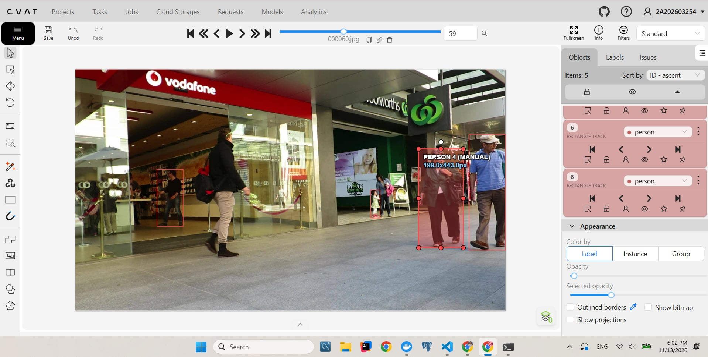
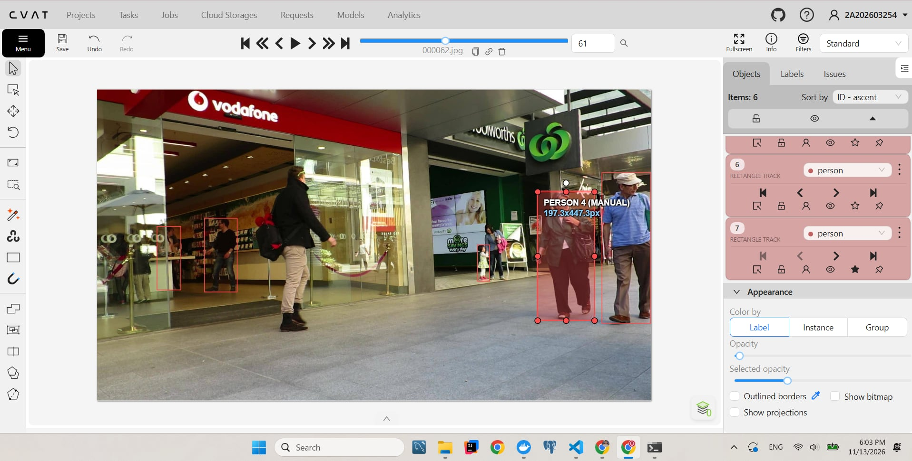
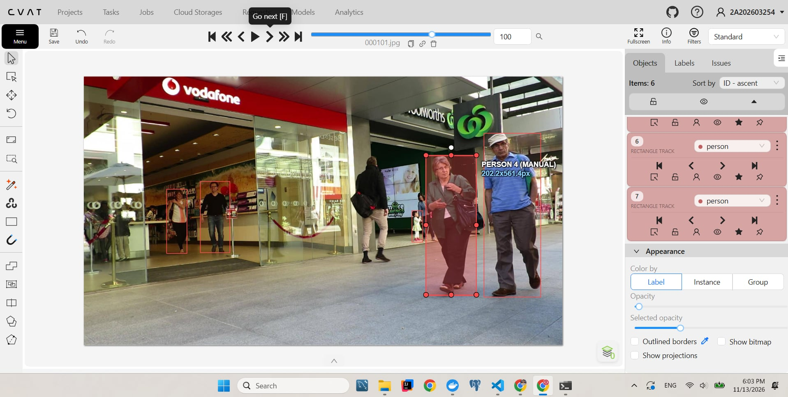

# Báo cáo cá nhân — HoVaTen-MSSV

Đổi tên file theo quy tắc `MSSV_HoTen.md`. Ví dụ: `20241234_NguyenVanAn.md`.

Đoạn video: MOT17-09, 150 frame (frame 1–150), nguồn MOTChallenge, giấy phép CC BY-NC-SA 3.0.

## 0. Thông tin học viên

- Họ tên:Phạm Việt Hoàng
- MSSV:2A202603254
- Mã đề (A/B/C):A
- Email:26ai.hoangpv2@vinuni.edu.vn
- Link repository:https://github.com/Pviethoang020704/K5-L2-DAY05-PhamVietHoang-2A202603254-MOTTracking-Sao-ch-p.git
- Giờ bắt đầu:4 giờ
- Giờ kết thúc:8 giờ

## 1. Xem trước đoạn video (CP0)

Ghi **trước khi vẽ**, mỗi người một dòng.

| Mã | Frame xuất hiện | Frame cuối thấy được | Rẽ / dừng / đổi tốc độ ở frame | Bị che ở frame | Ghi chú |
|---|---|---|---|---|---|
| P1 |0 |149 |100 |không bị che |áo đen quần bò |
| P2 |61 |149 |120 |60 |áo trắng quần đen |
| P3 |0 |149 |140 |không bị che |áo xanh quần đen |
| P4 |0 |149 |140 |không bị che |áo xanh quần nâu đen |
| P5 |0 |149 |130 |122 |bé gái áo trắng |

## 2. Keyframe và thời gian (CP1, CP4)

| Mã | Số keyframe | Keyframe ở frame | Số frame có mặt | Keyframe / 100 frame | Thời gian (phút) | Chỗ khó |
|---|---:|---|---:|---:|---|---|
| P tương ứng Track 0 | 16 | 0, 10, 20, 30, 40, 50, 60, 83, 102, 106, 107, 108, 139, 140, 145, 149 | 150 | 10,7 | 60 | không có |
| P tương ứng Track 1 | 16 | 0, 10, 20, 30, 40, 50, 60, 70, 80, 90, 100, 110, 120, 130, 140, 149 | 150 | 10,7 | 60 | không có |
| P tương ứng Track 2 | 16 | 0, 10, 20, 30, 40, 50, 60, 70, 80, 90, 100, 110, 120, 130, 140, 149 | 150 | 10,7 | 60 | không có |
| P tương ứng Track 3 | 21 | 0, 10, 20, 29, 30, 31, 35, 47, 49, 50, 54, 60, 70, 80, 90, 100, 110, 120, 130, 140, 149 | 150 | 14,0 | 60 | không có |
| P tương ứng Track 4 | 10 | 61, 70, 80, 90, 100, 110, 120, 130, 140, 149 | 89 | 11,2 | 60 | không có |
| **Tổng** | **79** | — | **689** | **11,5** | 300 | — |

Keyframe / 100 frame của cả bài = 79 ÷ 689 × 100 = **11,5**.

**Bạn đặt keyframe nhiều nhất ở người nào? Vì sao?**

Người tương ứng Track 3 có nhiều keyframe nhất (21 keyframe). Các keyframe được đặt dày hơn tại frame 29–35 và 47–54. Cần quan sát lại video để xác định nguyên nhân thực tế như thay đổi chuyển động, bị che hoặc box lệch nội suy.
## 3. Đoạn bị che (CP2)

Người bị che: `P5`

| Mốc | Frame |
|---|---:|
| Bắt đầu bị che một phần (bật `occluded`) |120 |
| Mất hẳn (bật `outside`) |122 |
| Hiện lại (tắt `outside`) |129 |
| Thấy rõ trở lại (tắt `occluded`) |140 |

- Thời gian khuất hẳn: 10 frame = 10 giây.
- Quyết định: giữ cùng ID 
- Lý do (trả lời 3 câu: khuất bao lâu so với 60 frame, ngoại hình có khớp, chỗ hiện lại có đúng hướng và tốc độ):

Thời gian khuất hẳn so với 60 frame: Chưa có đoạn outside để đối chiếu.

Ngoại hình: [Ghi đặc điểm quần áo, vóc dáng thực tế khi nhìn thấy lại].

Hướng và tốc độ: [Ghi nhận xét thực tế khi xem các frame liên tiếp].
Ảnh chụp màn hình:





## 4. Tự review ID (CP3)

**Lượt 1 – Review theo người:** Kiểm tra tính liên tục của từng Track ID, đối chiếu các đối tượng cần theo dõi và xác định Track bị tạo nhầm.

**Lượt 2 – Review theo cảnh:** Đối chiếu kết quả xuất dữ liệu với yêu cầu 5 Track ID và kiểm tra các cảnh báo do chương trình tự kiểm phát hiện.

| Frame | Mã người | Loại lỗi | Mô tả một câu | Phát hiện ở lượt | Đã sửa? |
|---:|---|---|---|---|---|
| 61–149 | Chưa xác định | `fragmentation` / `false_track` | Ban đầu có 6 Track thay vì 5, đã xóa Track tạo nhầm và xuất lại dữ liệu. | Kiểm tra dữ liệu xuất | Có |
| 0–149 | P1–P5 | — | Kiểm tra lại số lượng Track sau khi xuất, kết quả còn đúng 5 Track ID. | Kiểm tra bằng script | Có |
| 50 | Chưa xác định | `drift` (cần xác minh) | Chương trình cảnh báo chiều cao box thay đổi hơn 30% trong một frame; chưa xác định đây là lỗi gán nhãn thực tế. | Kiểm tra bằng script | Chưa xác minh |

**Tổng hợp số lỗi theo loại:**

| `id_switch` | `fragmentation` | `lost` | `merge` | `false_track` | `drift` | `flag` |
|---:|---:|---:|---:|---:|---:|---:|
| 0 | Chưa phân loại | 0 | 0 | Chưa phân loại | Chưa xác minh | 0 |

**Lỗi nào chỉ lượt 2 mới thấy, lượt 1 không thấy? Vì sao?**

Trong quá trình kiểm tra dữ liệu xuất bằng script, phát hiện số lượng Track ID ban đầu là 6, vượt yêu cầu 5 ID. Sau khi loại bỏ Track tạo nhầm, lưu lại và xuất dữ liệu mới, kết quả kiểm tra xác nhận còn đúng 5 Track ID và không có lỗi định dạng.

Ngoài ra, script phát hiện một cảnh báo thay đổi chiều cao Bounding Box đột ngột tại frame 50. Cảnh báo này cần đối chiếu trực tiếp với hình ảnh để phân biệt chuyển động thực tế và lỗi nội suy.
## 5. File xuất và kết quả tự kiểm (CP4)

| Kiểm tra | Kết quả |
|---|---|
| Tên file MOT 1.1 | `PhamVietHoang_mot.zip` |
| Tên file CVAT for video 1.1 | `PhamVietHoang_cvat_video.zip` |
| Số track ID khác nhau trong `gt/gt.txt` (phải là 5) | **5 — Đạt** |
| Frame `outside` không có dòng trong `gt.txt` (đúng / sai) | Không có frame `outside` được đánh dấu trong dữ liệu xuất; chưa có trường hợp để kiểm chứng |
| Job đã completed trên CVAT máy cá nhân | Chưa xác nhận |

**Kết quả chạy `src/check_submission.py`:**

```text
=== File MOT 1.1: PhamVietHoang_mot.zip ===
  Số track ID: 5   |   Tổng số box: 689
  [OK]        Đúng 5 track ID.

  Track | Frame có mặt | Số frame | Đoạn vắng (outside)
      1 |   0–149      |      150 | -
      2 |   0–149      |      150 | -
      3 |   0–149      |      150 | -
      4 |   0–149      |      150 | -
      5 |  61–149      |       89 | -

  [CẢNH BÁO] Track 4: chiều cao box đổi > 30%
  trong 1 frame ở frame [50].

=== File CVAT for video 1.1 ===
  Đọc được 5 track từ annotations.xml.

  Tổng: 79 keyframe / 689 frame có mặt
        = 11.5 keyframe / 100 frame

=== Tóm tắt ===
  Lỗi: 0   |   Cảnh báo: 1
  Không có lỗi định dạng.
```

**Nhận xét kết quả:**

Sau khi xóa Track tạo nhầm và xuất lại dữ liệu, chương trình tự kiểm xác nhận bài có đúng 5 Track ID và không còn lỗi định dạng.

Tổng cộng có 689 Bounding Box và 79 Keyframe, tương đương trung bình 11,5 Keyframe trên 100 frame có mặt.

Chương trình vẫn cảnh báo một trường hợp chiều cao Bounding Box thay đổi hơn 30% tại frame 50. Cảnh báo này chưa được xác định là lỗi thực tế và cần đối chiếu với hình ảnh trên CVAT.

Dữ liệu xuất hiện tại chưa ghi nhận lần bật trạng thái `outside`.
## 6. Ba câu kết

**1. Nếu được gán lại, bạn sẽ đặt keyframe khác ở đâu? Vì sao?**

Nếu được gán lại, tôi sẽ ưu tiên đặt thêm keyframe tại các đoạn người thay đổi hướng di chuyển, bị che khuất hoặc Bounding Box thay đổi kích thước đột ngột. Đặc biệt, tôi sẽ kiểm tra kỹ khu vực frame 49–51 vì chương trình phát hiện chiều cao Bounding Box thay đổi hơn 30%. Việc đặt keyframe phù hợp sẽ giúp nội suy chính xác hơn và giảm tình trạng box bị lệch giữa các frame.

**2. Có chỗ nào bạn không chắc "cùng ID hay ID mới"? Bạn đã quyết định và ghi chú thế nào?**

Trong quá trình gán nhãn, tôi từng tạo nhầm một Track khiến tổng số ID tăng lên 6 thay vì 5. Sau khi kiểm tra, tôi đã xóa Track tạo nhầm và giữ lại 5 Track theo yêu cầu. Với những trường hợp người bị che khuất, tôi ưu tiên giữ cùng ID nếu có thể xác nhận đó là cùng một người dựa trên ngoại hình và hướng di chuyển.

**3. Một lỗi ID trong job của bạn (nếu không còn sót, chọn lỗi đã sửa) có thể làm xe tự lái dự đoán sai chuyển động của người đó như thế nào? Lỗi đó ảnh hưởng MOTA hay IDF1 nhiều hơn?**

Lỗi tạo Track thừa có thể khiến hệ thống xe tự lái nhận diện nhầm một người thành hai đối tượng, từ đó tính toán sai số lượng người và quỹ đạo di chuyển. Nếu một người bị tách thành nhiều ID, hệ thống có thể mất tính liên tục của quỹ đạo và dự đoán sai vị trí tiếp theo.

Đối với lỗi đổi hoặc phân mảnh ID kéo dài, IDF1 thường chịu ảnh hưởng rõ hơn vì chỉ số này đánh giá tính nhất quán danh tính xuyên suốt các frame. MOTA cũng bị ảnh hưởng thông qua các lỗi nhận diện và chuyển đổi ID. Nếu lỗi chỉ là Track giả, MOTA có thể bị ảnh hưởng trực tiếp bởi số lượng false positive tăng lên.
## Bonus (nếu làm)

### B1 — Hai người đi sát

...

### B2 — So cách đặt keyframe

| Cách đặt | Số keyframe | Frame trôi nhất | Ghi chú |
|---|---:|---:|---|
| Đều mỗi 30 frame | | | |
| Theo chỗ đổi hướng | | | |

...

### B3 — So với tracker có sẵn

| Frame | Mã người | Tracker làm gì | Nhãn của bạn | Giải thích (đoán rồi sửa / ghép IoU / box score thấp / ngoại hình) |
|---:|---|---|---|---|
| | | | | |
| | | | | |

## 7. Tài liệu tham khảo và công cụ AI đã dùng

-  VinUni AI thực chiến – Day 05: Multi-Object Tracking (MOT). Tài liệu hướng dẫn thực hành, checkpoint và quy định nộp bài.
https://github.com/VinUni-AI20k/K5-L2-MOTTracking

-  CVAT Documentation. Tài liệu hướng dẫn sử dụng Track, Keyframe, Interpolation, Occluded và Outside trong gán nhãn đối tượng.
https://docs.cvat.ai/

-  MOTChallenge. Nguồn dữ liệu và tài liệu tham khảo về bài toán Multi-Object Tracking, định dạng MOT và các chỉ số đánh giá MOTA, IDF1.
https://motchallenge.net/